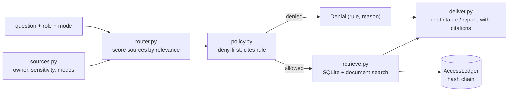

# Jagadish-governed-data-agent

[](https://github.com/jagadishmazure-jpg/Jagadish-governed-data-agent/actions/workflows/ci.yml)
[](https://github.com/jagadishmazure-jpg/Jagadish-governed-data-agent/actions/workflows/codeql.yml)


**One agent across structured and unstructured data, with governance applied like employee access: role and mode are checked against every source before anything is retrieved.**

> Personal learning and portfolio project. Everything runs offline on synthetic,
> fictional data with no API keys. Nothing is deployed. Numbers in this README
> come from real runs and are re-checked by CI (`scripts/render_docs.py --check`).

## Recruiter summary

- Deny-first routing: the policy removes forbidden sources before retrieval, so the retriever never touches them, and every denial cites a rule ID.
- Real run: an analyst gets Q3 sales by region in company mode, nothing in personal mode, and is refused compensation data that a manager can see; all five requests land on a hash-chained access ledger.
- Personal vs company modes, chat, table and report outputs; offline tests, CI with CodeQL and gitleaks.

## Purpose

Give an agent a database and a document store and it will happily answer from
all of them. But a compensation table is not a wiki. The same question from an
analyst, a manager or the employee should reach different data, and the decision
has to happen before retrieval, not as a filter on the answer. This repo is a small,
testable model of that for a fictional company.

## Architecture



## How it works

| Source | Kind | Sensitivity | Who can use it |
|---|---|---|---|
| sales | SQLite table | internal | company mode, any role |
| inventory | SQLite table | public | both modes |
| compensation | SQLite table | confidential | company mode, manager and above |
| policy_docs | documents | internal | company mode, any role |
| meeting_notes | documents | public (owner a.chen) | both modes |
| board_minutes | documents | confidential | company mode, manager and above |

Rules (`govdata/policy.py`), each with a stable ID for audit:
`POL-MODE-01` the mode must permit the source; `POL-PERS-02` personal mode sees
only the user's own data and public sources; `POL-ROLE-03` company mode needs a
role that clears the sensitivity. The router applies the policy to every source,
including ones below the relevance threshold, so denials are explicit.
Model detail: [docs/governance-model.md](docs/governance-model.md).

## Real code and output

```python
"""Same questions, different roles and modes: governance decides before any data is read (offline)."""
from govdata import AccessLedger, build_registry, deliver, execute_plan, route_request

reg = build_registry()
ledger = AccessLedger()
asks = [
    ("What is total Q3 revenue by region?", "analyst", "company"),
    ("What is total Q3 revenue by region?", "analyst", "personal"),
    ("What is the average salary by department?", "analyst", "company"),
    ("What is the average salary by department?", "manager", "company"),
    ("What does the travel policy say about expenses?", "analyst", "company"),
]
for question, role, mode in asks:
    plan = route_request(question, role=role, mode=mode, registry=reg)
    result = execute_plan(plan, reg)
    ledger.log(plan, result)
    print(f"[{role}/{mode}] {question}")
    print(f"  allowed sources: {plan.allowed_names or '-'}")
    for d in plan.denied:
        print(f"  denied {d.name}: {d.rule}")
    for line in deliver(plan, result, fmt="chat").splitlines()[1:5]:
        print("  |", line)
    print()
print(f"Access ledger: {len(ledger.entries)} entries, chain verifies: {ledger.verify_chain()}")
```

Output of `python examples/demo.py` (real run, re-checked in CI):

<!-- run: python examples/demo.py -->
```text
[analyst/company] What is total Q3 revenue by region?
  allowed sources: ['sales']
  denied compensation: POL-ROLE-03
  denied board_minutes: POL-ROLE-03
  | 3 result(s) from: sales.
  | - region=central, total=11200.0 [sales:central]
  | - region=east, total=9990.0 [sales:east]
  | - region=west, total=6180.0 [sales:west]

[analyst/personal] What is total Q3 revenue by region?
  allowed sources: -
  denied sales: POL-MODE-01
  denied compensation: POL-MODE-01
  denied policy_docs: POL-MODE-01
  denied board_minutes: POL-MODE-01
  | No results from the sources I can access.
  | I couldn't use: sales (POL-MODE-01), compensation (POL-MODE-01), policy_docs (POL-MODE-01), board_minutes (POL-MODE-01).

[analyst/company] What is the average salary by department?
  allowed sources: -
  denied compensation: POL-ROLE-03
  denied board_minutes: POL-ROLE-03
  | No results from the sources I can access.
  | I couldn't use: compensation (POL-ROLE-03), board_minutes (POL-ROLE-03).

[manager/company] What is the average salary by department?
  allowed sources: ['compensation']
  | 2 result(s) from: compensation.
  | - employee=a.chen, band=L4, base=125000.0 [compensation:a.chen]
  | - employee=b.okafor, band=L5, base=148000.0 [compensation:b.okafor]

[analyst/company] What does the travel policy say about expenses?
  allowed sources: ['policy_docs']
  denied compensation: POL-ROLE-03
  denied board_minutes: POL-ROLE-03
  | 2 result(s) from: policy_docs.
  | - doc_id=POL-1, title=Travel expense policy, snippet=Employees may claim up to $180 per night for lodging. Meals are reimbursed up to $75 per day with receipts. First-class flights require VP approval. [policy_docs:POL-1]
  | - doc_id=POL-2, title=Remote work policy, snippet=Employees may work remotely up to three days per week. Hardware requests go through IT with manager approval. [policy_docs:POL-2]
  | I couldn't use: compensation (POL-ROLE-03), board_minutes (POL-ROLE-03).

Access ledger: 5 entries, chain verifies: True
```
<!-- /run -->

## How to run

```bash
git clone https://github.com/jagadishmazure-jpg/Jagadish-governed-data-agent.git
cd Jagadish-governed-data-agent
python -m pip install pytest      # no runtime dependencies
python -m pytest -q          # offline, no keys
python examples/demo.py
python scripts/render_docs.py --check   # documented output still matches
```

Test suite size (real collection, re-checked in CI):

<!-- run: python scripts/count_tests.py -->
```text
34 tests collected
```
<!-- /run -->

## Guardrails

- Deny-first: policy runs before retrieval and the retriever only receives allowed sources.
- Every allow and deny decision cites a stable rule ID and reason.
- Confidential sources need manager or above in company mode.
- Personal mode is limited to the user's own data and public sources.
- Every request is logged with role, mode, allowed and denied sources and queries run, on a hash-chained ledger.

## Limitations

- Retrieval is keyword-based: 'average salary by department' returns the matching rows, not an average, and 'Q3' is not used as a filter.
- Roles are string literals, not identity-provider claims.
- The policy covers source-level access; there is no row- or column-level filtering inside a source.
- Small fictional data set in SQLite and in-memory documents.

## Built vs planned

| Capability | Status | Where |
|---|---|---|
| Source registry with owner, sensitivity and modes | Built | `govdata/sources.py` |
| Deny-first policy with rule IDs | Built | `govdata/policy.py` |
| Relevance router that applies policy to every source | Built | `govdata/router.py` |
| Structured and document retrieval, three output formats | Built | `govdata/retrieve.py`, `govdata/deliver.py` |
| Hash-chained access ledger | Built | `govdata/audit.py` |
| Entra ID group claims as roles | Planned | docs/implementation-guide.md |
| Purview sensitivity labels as the registry source | Planned | docs/implementation-guide.md |
| Aggregation-aware SQL generation | Planned | see Jagadish-text2sql-data-agent |

## Implementation guide

The step-by-step path from this offline build to an Azure deployment is in
[docs/implementation-guide.md](docs/implementation-guide.md). None of it has been
run; it is a plan.

## Related repositories

| Repo | How it relates |
|---|---|
| [Jagadish-text2sql-data-agent](https://github.com/jagadishmazure-jpg/Jagadish-text2sql-data-agent) | Safe SQL generation with role column rules; the natural query engine behind this router |
| [Jagadish-fabric-enterprise-bi](https://github.com/jagadishmazure-jpg/Jagadish-fabric-enterprise-bi) | Governed Fabric data agent over a semantic model |
| [Jagadish-agentic-data-layer](https://github.com/jagadishmazure-jpg/Jagadish-agentic-data-layer) | Governed MCP/A2A gateway over data products |
| [Jagadish-agent-identity-security](https://github.com/jagadishmazure-jpg/Jagadish-agent-identity-security) | Identity posture for the people and agents that hold these roles |

## Documentation

- [Governance model](docs/governance-model.md)
- [Implementation guide (Azure)](docs/implementation-guide.md)
- [Interview points](docs/interview-points.md)
- [Security policy](SECURITY.md)

## Project layout

```
govdata/
  sources.py   registry + fictional SQLite tables and documents
  policy.py    deny-first access policy with rule IDs
  router.py    relevance scoring + policy -> RetrievalPlan
  retrieve.py  executes only planned sources
  deliver.py   chat / table / report outputs with citations
  audit.py     hash-chained access ledger
examples/demo.py the run shown above
tests/           offline pytest suite
```

## License

MIT, see [LICENSE](LICENSE). All data is synthetic; every organisation and person is fictional.
